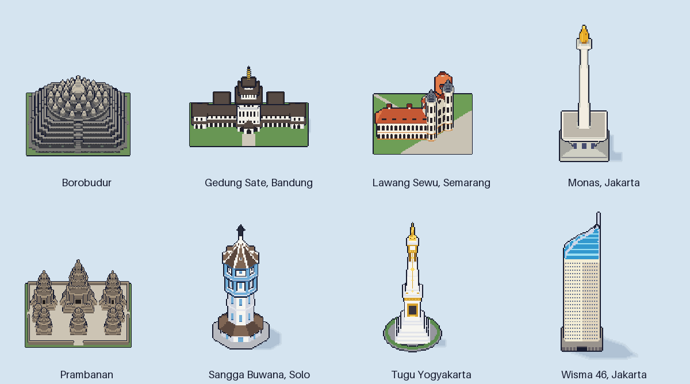

# Pixel art Indonesia

Eight Indonesian landmarks as rotating pixel art, made with sprite stacking: each model is a stack of flat top-down slices, drawn one above the other and turned together, which reads as 3D.



| Model | Place | Slices |
|---|---|---|
| Borobudur | Magelang, Central Java | 56 |
| Gedung Sate | Bandung | 64 |
| Lawang Sewu | Semarang | 60 |
| Monas | Jakarta | 126 |
| Prambanan | Yogyakarta | 70 |
| Panggung Sangga Buwana | Solo | 106 |
| Tugu Yogyakarta | Yogyakarta | 112 |
| Wisma 46 | Jakarta | 114 |

## What is in each folder

`models/<name>/` holds:

- `turntable.gif`: the model turning, 48 frames.
- `slices.png`: the model itself, one strip of slices with the ground slice on the left.
- `build.py`: builds the voxel grid in NumPy and writes `slices.png`. Six models have this.
- `views.py` and `views.png` (Monas and Wisma 46 only): these two were drawn as four flat views and carved into slices with the slicer from [danielwh2/sprite-stacking](https://github.com/danielwh2/sprite-stacking). That slicer is not included here.
- `render_gif.py`: turns `slices.png` into `turntable.gif`.

`tools/` holds:

- `make_grid.py`: tiles every `turntable.gif` into `all-landmarks.gif`.
- `stack_render.py`: a newer renderer with render-time lighting, contact shadows and inner outlines. The eight models above were rendered with the older `render_gif.py`.
- `check_model.py` and `compare.py`: checks and side-by-side sheets for the newer renderer.

## Run it

Python 3 with Pillow and NumPy.

```bash
pip install pillow numpy
```

```bash
python models/borobudur/build.py
```

```bash
python models/borobudur/render_gif.py --count 56
```

```bash
python tools/make_grid.py
```

`render_gif.py` needs `--count` set to the model's slice count from the table above when its default differs.

## How they were made

An AI coding agent (Claude) wrote each `build.py` from a text brief and reference photos, rendered the model, looked at the frames and fixed what read wrongly, a few rounds per model. No image generator drew the slices: they are cross-sections of a voxel grid, so they agree with each other.

The models are simplified and not to scale.
